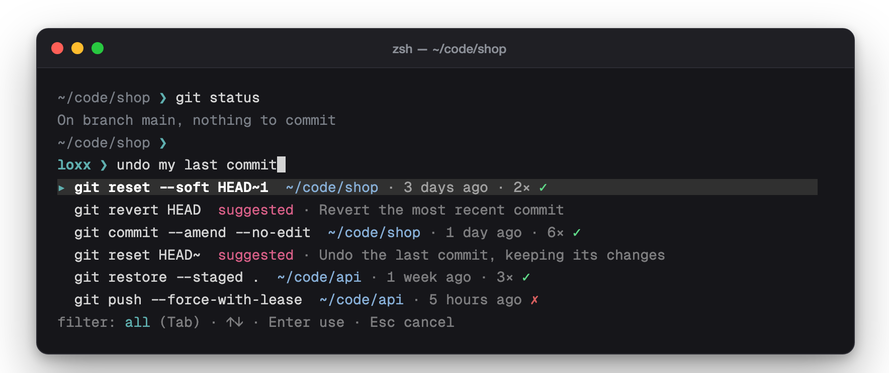

# loxx

Find any command you ran before, even if you only remember what it did, or
the closest command for what you want to do, even if you have never run it.

<p align="center"></p>

Press **Ctrl-Alt-G** in your terminal and describe what you want, like
"undo my last commit" or "restart the web server", or type part of the
command, like "port-forward". Pick one with Enter and it lands in your prompt,
ready to edit. loxx never runs anything for you.

- **Private.** Everything stays on your computer. loxx never uses the internet.
- **Safe.** Passwords, API keys and tokens are removed before anything is saved.
- **Fast.** It remembers every command in the background; your prompt never waits.

**[Website](https://loxx.run)** · [Docs](https://loxx.run/docs/) ·
[Download](https://loxx.run/download/) ·
[Try it in your browser](https://loxx.run/#play)

## Install

Linux with bash or zsh, or macOS with zsh (the Mac default). Not Windows.

```
curl -fsSL https://loxx.run/install | sh
```

Then open a new terminal, or run `exec zsh` in this one. The installer checks
the download is genuine, puts loxx in `~/.local/bin`, adds a marked block to
your shell settings and loads your old history. It doesn't need `sudo`.

- **Update:** run the same line again. Your history is kept.
- **Uninstall:** `loxx uninstall`. It puts your shell settings back exactly as
  they were and asks before deleting your history.

The same installer, straight from GitHub:
`curl -fsSL https://github.com/AniketR10/loxx/releases/latest/download/install.sh | sh`.
To download a file yourself, see the [download page](https://loxx.run/download/#files).

On a Mac the key is **Ctrl-Option-G**, with "Use Option as Meta key" turned on
in your terminal's settings ([how](https://loxx.run/docs/troubleshooting/#ctrl-g)).
The bash that comes with macOS is too old for loxx; zsh works.

## Use

| Key | What it does |
|---|---|
| Ctrl-Alt-G | Open the search. Anything already typed on the line becomes the search. |
| Type | Search. Exact matches show at once, matches by meaning a moment later. |
| ↑ ↓ | Move through the list. |
| Tab | Show only commands from this folder, from this terminal, or ones that failed. |
| Enter | Put the command in your prompt, ready to edit or run. |
| Esc | Close without choosing; your line stays as it was. |

Typing `loxx` and pressing Enter opens the same list.

Rows marked `suggested` are the closest commands for what you want to do,
from about 29,000 examples, shown only for programs installed on your
computer. Choosing one puts the cursor on the first word to replace. Search by
meaning always shows the closest matches, even when none is a good match.
More in [Searching](https://loxx.run/docs/usage/).

| Command | What it does |
|---|---|
| `loxx search <words>` | Print matches instead of opening the list. |
| `loxx status` | How many commands are saved, and whether loxx is working. |
| `loxx forget --last` | Delete the command you just ran, e.g. if you typed a password. |
| `loxx forget --match TEXT` | Delete every command that contains TEXT. |
| `loxx help` | Every command. |

All commands and their options: [Commands](https://loxx.run/docs/commands/).

## Privacy

- Your commands are saved only on your computer, in `~/.local/share/loxx`, and
  only you can read them. Nothing is synced between computers.
- loxx removes secrets it recognizes (API keys, tokens, passwords, private
  keys) before saving, and shows them as `<REDACTED:…>`.
- **Start a command with a space** and loxx won't save it at all. Do that for
  an unusual secret loxx may not recognize, or run `loxx forget --last`.
- `loxx forget` deletes commands completely, including from the files on disk.

More in [Privacy and secrets](https://loxx.run/docs/privacy/), including what
loxx [can't catch](https://loxx.run/docs/privacy/#limits).

## What loxx changes on your computer

| Where | What |
|---|---|
| `~/.local/bin/loxx` | The program (one file). |
| `~/.bashrc` and/or `~/.zshrc` | One marked block (on a Mac, only `~/.zshrc`). |
| `~/.local/share/loxx/` | Your saved commands (`history.db`, an SQLite database). |
| `~/.local/state/loxx/` | A note that the installer put the program there, so uninstall can remove it. |

The block in your shell settings:

```
# >>> loxx >>>
[ -x '/home/you/.local/bin/loxx' ] && eval "$('/home/you/.local/bin/loxx' init bash)"
# <<< loxx <<<
```

If `~/.local/bin` isn't in your `PATH` (it usually isn't on a Mac), the hook
adds it at the end, so `loxx` works everywhere, scripts included.

## How it works

1. After every command, your shell starts `loxx record` in the background. It
   saves the command, folder, exit code and duration, adding about 1 to 4 ms.
2. Secrets are removed before anything is saved.
3. In the background, each new command is turned into numbers that capture its
   meaning, by a small language model built into the program
   ([all-MiniLM-L6-v2](https://huggingface.co/sentence-transformers/all-MiniLM-L6-v2)).
4. A search combines exact words and closest meaning, so both "port-forward"
   and "expose my service locally" work. Suggestions come from
   [tldr-pages](https://github.com/tldr-pages/tldr) examples.

Everything lives in one SQLite file, and the search list opens in about 25 ms
even with 100,000 saved commands. The program
is about 80 MB because the model and the examples are built in. More in
[How it works](https://loxx.run/docs/how-it-works/).

## Settings

There is no settings file. These environment variables cover the rare cases:

| Variable | What it does |
|---|---|
| `LOXX_DB_PATH` | Save history to a different file. |
| `LOXX_BACKGROUND_EMBED=0` | Don't process new commands in the background (search by meaning then only covers what `loxx embed --pending` has processed). |
| `LOXX_QUIET=1` | Hide "loxx is on" when a terminal opens. |
| `NO_COLOR=1` | Turn off colors (the [common switch](https://no-color.org) many tools honour). |

Also on the site: [Settings](https://loxx.run/docs/troubleshooting/#settings).

## If something seems wrong

Run `loxx status`: it shows what's saved, whether the hook is in your shell
settings and active in this terminal, and whether search by meaning is ready.

- **Commands aren't saved:** open a new terminal. If `loxx status` says the
  hook isn't in your settings, run `loxx setup`.
- **Search by meaning misses new commands:** run `loxx embed --pending`.
- **bash:** keep the loxx block at the end of `~/.bashrc`; tools that change
  `PROMPT_COMMAND` after it can switch it off.

More in [Troubleshooting](https://loxx.run/docs/troubleshooting/).

## Check a download is genuine

Every release file has a signed record of how GitHub built it:

```
gh attestation verify loxx-linux-amd64 --repo AniketR10/loxx
```

Use the file you downloaded: `loxx-linux-amd64`, `loxx-linux-arm64`,
`loxx-darwin-arm64` (Apple chip) or `loxx-darwin-amd64` (Intel Mac). You can
also [compare the checksum](https://loxx.run/download/#verify).

## Build it yourself

You need Go 1.25 or newer, `make` and `curl`:

```
git clone https://github.com/AniketR10/loxx
cd loxx
make build
bin/loxx setup
```

The first build downloads the model and the command list (about 90 MB). See
[CONTRIBUTING.md](CONTRIBUTING.md) to help develop loxx.

## License

MIT. See [LICENSE](LICENSE). The built-in model has its own license:
[internal/embed/model](internal/embed/model/). The built-in command list is
made from [tldr-pages](https://github.com/tldr-pages/tldr) by the tldr-pages
team and contributors, under
[CC BY 4.0](https://creativecommons.org/licenses/by/4.0/), with placeholders
and descriptions simplified: see
[internal/library/TLDR-LICENSE.md](internal/library/TLDR-LICENSE.md).
